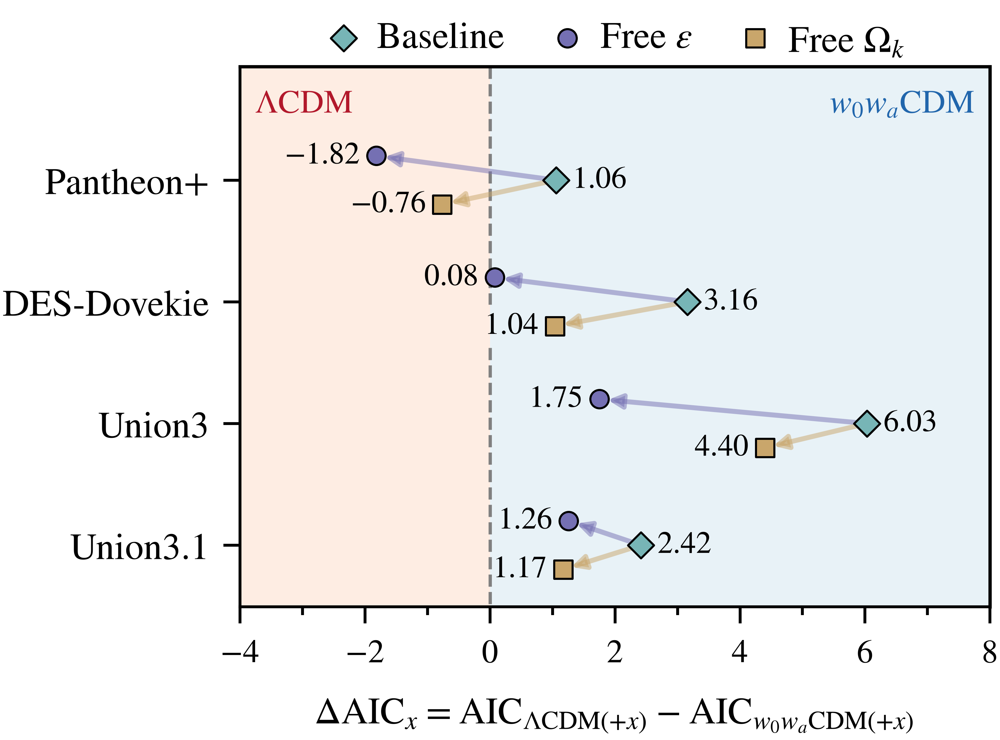

<p align="center">
  
</p>

## Title
Sensitivity of calibration-free DESI DR2 BAO–supernova constraints to a distance-duality tilt

## Abstract
Recent measurements from DESI baryon acoustic oscillations (BAO) have reported a moderate preference for dynamical dark energy, challenging the $\Lambda$CDM paradigm. Nonetheless, such a trend could reflect a tension between the shape and the offset of the Hubble diagrams predicted by current BAO and Type Ia supernovae (SN) data, which may underpin a possible breakdown of the cosmic distance duality relation linking luminosity distances $D_{\rm L}$ and angular-diameter distances $D_{\rm A}$. We explore this possibility by parametrizing deviations from this relation as $\eta(z)\equiv D_{\rm L}/[{(1+z)}^2D_{\rm A}]=\alpha{(1+z)}^\varepsilon$, and investigate how the preference for a Chevallier-Polarski-Linder (CPL) dynamical dark energy is modified once $\varepsilon\neq0$ is allowed. Using DESI DR2 and uncalibrated SN data (Pantheon$+$, DES-Dovekie, Union3, and Union3.1), we find that allowing $\varepsilon$ to vary freely in both $\Lambda$CDM and CPL reduces the CPL preference with respect to $\Lambda$CDM by a larger amount than the addition of spatial curvature $\Omega_k$; only Union3.1 exhibits comparable reductions. We also find that the preference reduction is robust to alternative $\eta(z)$ parametrizations, and that the $\eta(z)$ constraints remain stable under the removal of BAO tracers or low-redshift cutoffs for Pantheon$+$, whereas the DES-Dovekie preference largely disappears once $z<0.1$ SN are removed. In a separate calibrated analysis, illustrative Planck sound-horizon and SH0ES absolute-magnitude priors give $\alpha\simeq0.942\pm0.014$, quantifying the normalization mismatch under those assumptions. We also discuss photon-loss and varying-$G$ interpretations: ordinary positive opacity cannot explain the negative central tilts $\varepsilon$ found for a $\Lambda$CDM background, while local gravity tests strongly constrain the illustrative unscreened varying-$G$ scenario.

## Reproducing the results
All codes, archived posteriors and minima needed to regenerate the figures and tables of the paper are included in this repository. Step-by-step instructions to install the environment, regenerate the outputs, rerun the inference and validate the release are given in [REPRODUCING.md](REPRODUCING.md).

## Citing the paper
If you use any of the above codes or the figures in a published work please cite the following paper:
<br>*Sensitivity of calibration-free DESI DR2 BAO–supernova constraints to a distance-duality tilt*
<br>Stéphane Fay, Mikel Artola, Leandros Perivolaropoulos

INSPIRE: [3214333](https://inspirehep.net/literature/3214333)

arXiv: [2610.16496](https://arxiv.org/abs/2610.16496) [astro-ph.CO]

DOI: [10.48550/arXiv.2610.16496](https://doi.org/10.48550/arXiv.2610.16496)

```bibtex
@article{Fay:2026dsa,
    author        = "Fay, St\'ephane and Artola, Mikel and Perivolaropoulos, Leandros",
    title         = "{Sensitivity of calibration-free DESI DR2 BAO--supernova constraints to a distance-duality tilt}",
    eprint        = "2610.16496",
    archivePrefix = "arXiv",
    primaryClass  = "astro-ph.CO",
    doi           = "10.48550/arXiv.2610.16496",
    month         = "10",
    year          = "2026"
}
```

The code is released under the [MIT license](LICENSE); the observational data retain their upstream terms, documented in [data/SOURCES.md](data/SOURCES.md).

Any further questions/comments are welcome.
